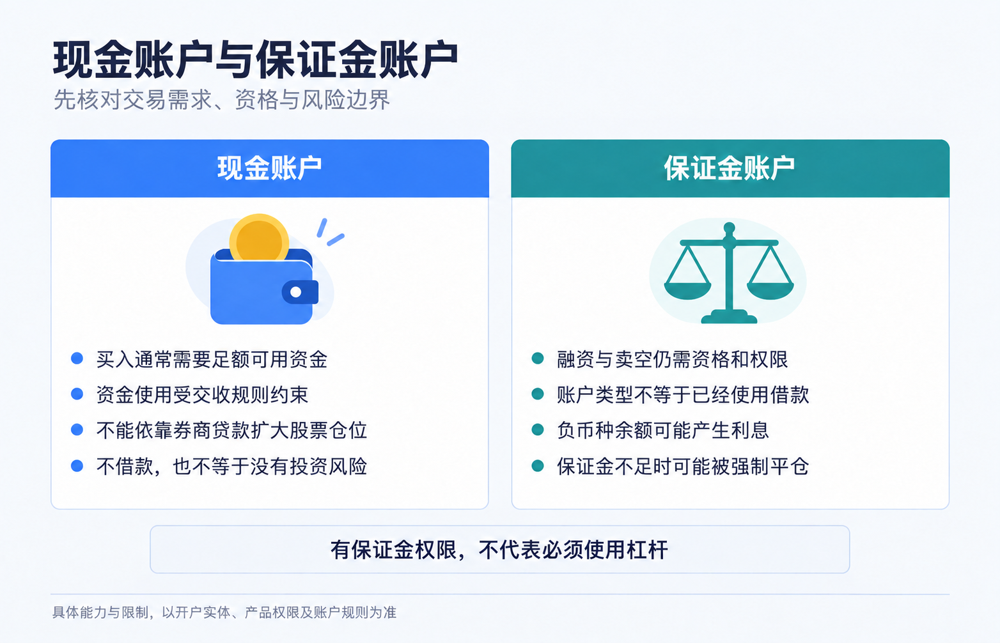
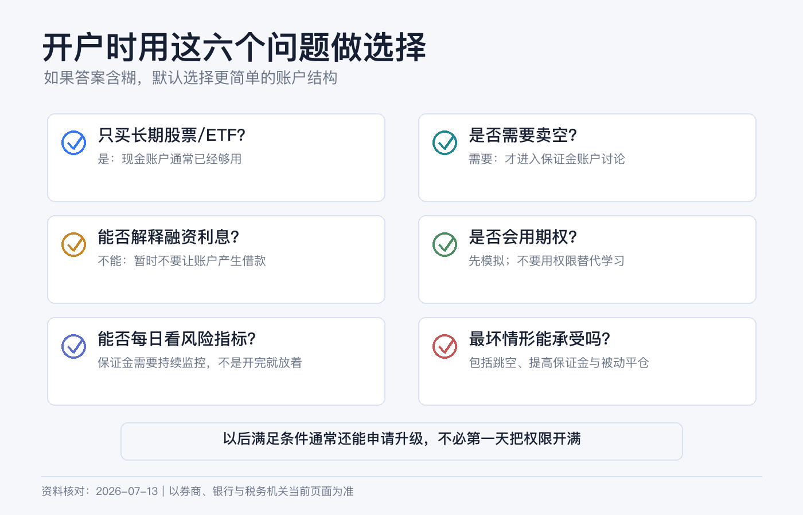

# 现金账户和保证金账户差在哪里：借款、交收与强平风险

如果你的计划只是用自有资金买入普通美股或 ETF，现金账户通常可以满足这类需求，具体仍取决于产品权限。保证金账户增加的是借款和担保安排：满足条件时可融资，保证金不足时券商可以处置持仓。开通这类账户本身，不等于已经借钱。

对没有明确借款、卖空或特定衍生品需求的新手，本文给出的保守起点是：**先研究现金账户。** IBKR 允许符合条件的现金账户之后申请升级，没必要在开户第一天为“以后可能用到”提前承担误借款和强平风险。

> 本文是账户机制与风险教育，不构成开户、融资、投资、税务或法律建议。IBKR 不同实体、居住地、产品和交易所适用的账户类型与保证金规则不同，开户前应阅读本人账户协议和实时保证金要求。资料核对日期：2026-08-23。

## 先把几个词说清楚

| 概念 | 实际含义 |
|---|---|
| 现金账户 Cash | 买入时要用自己的钱全额支付，不能形成融资借款，也不能卖空股票。账户仍可持有股票、ETF、债券等证券。 |
| 保证金账户 Margin | 满足条件时可用资产作抵押借款；卖空和部分期权策略另需权限。持有多币种本身不要求保证金账户。 |
| 已交收现金 Settled Cash | 已完成交收、可按规则使用的现金，不等于页面上的所有现金变动。 |
| 购买力 Buying Power | 券商按现金、持仓和保证金规则计算的下单上限；它不是“建议投入金额”。 |
| 初始保证金 | 建仓时需要由你提供的最低权益。 |
| 维持保证金 | 持仓期间必须持续保有的最低权益。 |
| 超额流动性 Excess Liquidity | IBKR 证券分部为 Equity with Loan Value 减维持保证金；商品分部使用 Net Liquidation Value 减维持保证金。它是当前保证金缓冲，不是可提款现金，也不是未来不被平仓的保证。 |
| 借方余额 Debit Balance | 某个币种现金为负，通常代表你正在借款并可能产生利息。 |

## 两类账户到底差在哪里

| 维度 | 现金账户 | 保证金账户 |
|---|---|---|
| 买入资金 | 原则上要有足够的已交收现金覆盖成交与费用。 | 可使用自有资金加券商贷款，但每种证券的可融资比例不同。 |
| 卖空股票 | 不允许。 | 可能允许，但还需要权限、可借券源并承担借券费等成本。 |
| 卖出款再使用 | 要遵守产品交收周期。 | 券商可立即把买卖款纳入购买力计算，但不代表没有融资风险。 |
| 多币种 | 可以持有和交易多币种，但不能借入某币种。 | 一种货币为正、另一种为负时，可能已在借外币。 |
| 期权 | 通常只开放全额支付或有充分覆盖的有限策略。 | 可申请更多策略，但权限审批与保证金要求是另外两道门槛。 |
| 风险下限 | 普通全额买入股票，损失通常以投入金额为限。 | 杠杆、卖空和衍生品可能令损失超过初始投入。 |
| 强制平仓 | 普通股票全额持有不因价格下跌产生保证金追缴，但费用、交割等仍可能造成负余额风险。 | 权益不足时可被实时平仓，且不保证先通知或让你挑选卖哪只。 |

## 现金账户的约束：慢一点，但边界清楚

现金账户最重要的规则不是“账户里有现金”，而是**付款和交收必须对得上**。

美国大多数适用证券自 2024 年 5 月 28 日起采用 T+1 标准交收：周一卖出，通常周二完成交收，节假日另算。不要将这一规则直接套用于所有市场、基金份额、外汇或特殊交易；应看具体产品的成交确认和结算日，而不是只凭“股票”或“债券”名称判断。

现金账户常见错误是把尚未交收的卖出款当成随时可反复使用的现金，买入新证券后又在付款完成前卖掉。按适用规则，这可能构成现金交易违规，券商可以拒单或限制账户。Settled Cash 是重要起点，但不能把汇总金额当作每一笔订单都能使用的预算：还应核对交易币种、兑换与证券交收安排，以及成交金额之外的佣金等费用。

实际操作时，先查看分币种现金和已有未成交订单，再用订单预览核对本笔资金需求；预览也不是成交保证。提款则查看 Cash Available for Withdrawal，不把可交易金额当成可转出金额。IBKR 对这两个用途有不同的字段和限制，参见[可交易资金说明](https://www.ibkrguides.com/traderworkstation/available-for-trading.htm)与[可提款现金说明](https://www.interactivebrokers.com/campus/glossary-terms/cash-available-for-withdrawal/)。

如果账户同时显示 Cash、Settled Cash、Buying Power 和 Net Liquidation Value，可按[券商账户六个数字的核对顺序](/blog/brokerage-account-balances/)逐项确认，不要用一行总资产替代现金交收判断。

## 有借款时，损失如何放大

以下是教学模拟，不是作者交易记录，也不代表券商一定批准该借款比例。是否已经融资，需要结合分币种现金、交收与利息记录判断，不能只看账户类型。

假设你有 5,000 美元，用保证金再借 5,000 美元，买入 10,000 美元股票。若股票下跌 20%，市值剩 8,000 美元；先不计利息和费用，扣除 5,000 美元贷款后，你的权益只剩 3,000 美元，亏损是自有资金的 40%。

杠杆把上涨和下跌同时放大，而且还会增加三类成本：

1. **融资利息。** IBKR 按币种和借款档位计算，利息按日累计、按月入账，利率会变化。
2. **规则变化。** 监管、交易所和券商都可以调整保证金；某只证券也可能从可融资变为要求 100% 资金。
3. **被动处置。** 你可能在不希望卖出或价格不利时被平仓；处置收入不足以偿还债务时，仍需承担剩余负债。

这些风险可能叠加，但不必依次发生。单独一次价格变化或保证金要求提高，就可能造成缺口；也不必等到系统先发出预警。

## IBKR 的强平规则尤其要看懂

很多人以为券商会先打电话，再给几天补钱。IBKR 官方明确说明：其系统实时计算保证金，通常**不发传统意义上的 margin call**；一旦出现保证金缺口，可能实时自动平仓。平台会尽力发送预警，但快速行情下不保证你有时间入金。

FINRA 的[保证金风险披露规则 2264](https://www.finra.org/rules-guidance/rulebooks/finra-rules/2264)也提醒，券商可以提高自己的 house requirement，可以不事先书面通知；为满足要求，券商不一定先联系客户，也不必让客户选择卖出哪项资产。这是 FINRA 成员证券保证金账户的披露依据，其他签约实体仍需查看当地规则和本人协议。

现金账户也不是绝对不会被处置持仓。IBKR 的[预警说明](https://www.interactivebrokers.com/campus/glossary-terms/margin-warning/)明确提到，期权行权交割等情况可能导致现金账户需要平仓以满足付款或避免借款。因此，“不能主动融资买股票”不等于“任何情况下都不会出现资金缺口”。

所以，保证金账户里的 Excess Liquidity 不是装饰数字。它下降时要立刻理解原因，而不是等“客服通知”。

## 还有一个隐蔽风险：借错货币

假设账户持有港币，买入美元计价股票时不能只看折算后的总购买力。在保证金账户中，订单可能通过并形成美元负余额；有其他币种资产，不代表美元债务已被偿还。

现金账户也不能一概写成“必须先手动换汇”。例如 [IBKR 新加坡客户协议](https://gdcdyn.interactivebrokers.com/Universal/servlet/Registration_v2.formSampleView?formdb=4664)包含现金账户自动换汇安排；是否适用须看本人签约实体、账户和服务条款，不能将一个实体的安排推广到所有账户。

区分两种情况的方法是核对报表：是否实际发生货币兑换、相应结算日是什么、交易后各币种余额及应计利息如何变化。自动换汇与借入外币不是一回事，也不要因订单获准就认定一定没有借款或费用。

基础货币、分币种现金和外币负余额的关系，可继续对照[IBKR 基础货币与换汇概念说明](/blog/ibkr-base-currency-and-fx/)核验。

## 5 类新手怎么选

| 你的真实需求 | 更合适的起点 |
|---|---|
| 每月定投普通股票或 ETF，不卖空、不做期权 | 现金账户。 |
| 偶尔卖出后想立刻再买，但不想使用杠杆 | 可先研究现金账户的交收安排；若申请保证金，应同时检查分币种已交收现金、待交收交易和费用，不能只靠当前余额非负判断没有融资。 |
| 需要卖空股票 | 保证金账户，但卖空还有权限、借券、费用和无限损失风险，不适合作为新手起点。 |
| 需要价差、裸卖等特定期权策略 | 可能需要保证金账户和额外权限；先在模拟账户理解到期与指派风险。 |
| 只是觉得“购买力越大越好” | 现金账户。购买力不是福利额度。 |

## 开户和后续升级怎么走

如果核对需求和限制后决定使用现金账户，新开户时在账户类型页面选择 Cash，并如实填写财务信息、投资目标和交易经验。不要为了通过审批夸大收入、净资产或经验。

以后确有需求，可以在 Client Portal 尝试：

`右上角用户菜单 → Settings → Account Configuration → Account Type`

选择从 Cash 升级到 Margin 后，需要满足资格要求、更新交易权限并签署风险披露，最终是否批准由 IBKR 决定。不同实体对能否降级、如何降级规定不同，不要把“以后再改回去”当作当然；操作前向本人账户实体确认。

即使已经是保证金账户，也可以用“现金方式”管理：

- 下单金额以已交收现金为上限，不以 Buying Power 为上限。
- 每天检查各币种现金，任何负数都查明来源。
- 关注 Available Funds、Excess Liquidity 和 Accrued Interest。
- 不开启卖空、复杂期权和自己还不懂的权限。
- 给费用、汇率变化和公司行动留现金缓冲。

## 开户前最后检查清单

- 我能用一句话说清为什么需要保证金，而不是“可能以后有用”。
- 我知道美国适用证券通常 T+1 交收，但其他市场和产品可能不同。
- 我知道负的外币余额可能是借款，不是自动换汇。
- 我看过当前融资利率和本人账户实体的保证金协议。
- 我接受 IBKR 可能实时平仓，且未必先通知或让我选卖什么。
- 我不会把 Buying Power 当作自己的钱。

如果这些问题还没有答案，先弄清规则再申请额外权限。现金账户限制融资，但并不消除证券价格、汇率、交收或操作风险。

## 参考资料

- Interactive Brokers, [Configuring Your Account](https://www.interactivebrokers.com/en/accounts/configuring-your-account.php).
- IBKR Campus, [Margin Account](https://www.interactivebrokers.com/campus/glossary-terms/margin-account/).
- IBKR Campus, [Margin Call](https://www.interactivebrokers.com/campus/glossary-terms/margin-call/).
- Interactive Brokers, [Margin Rates and Financing](https://www.interactivebrokers.com/en/trading/margin-rates.php).
- IBKR Client Portal Guide, [Account Type](https://www.ibkrguides.com/clientportal/accounttype.htm).
- SEC, [Statement on Implementation of the T+1 Settlement Cycle](https://www.sec.gov/newsroom/press-releases/2024-62).
- FINRA, [Brokerage Accounts](https://www.finra.org/investors/investing/investment-accounts/brokerage-accounts).
- FINRA, [Know What Triggers a Margin Call](https://www.finra.org/investors/insights/margin-calls).
