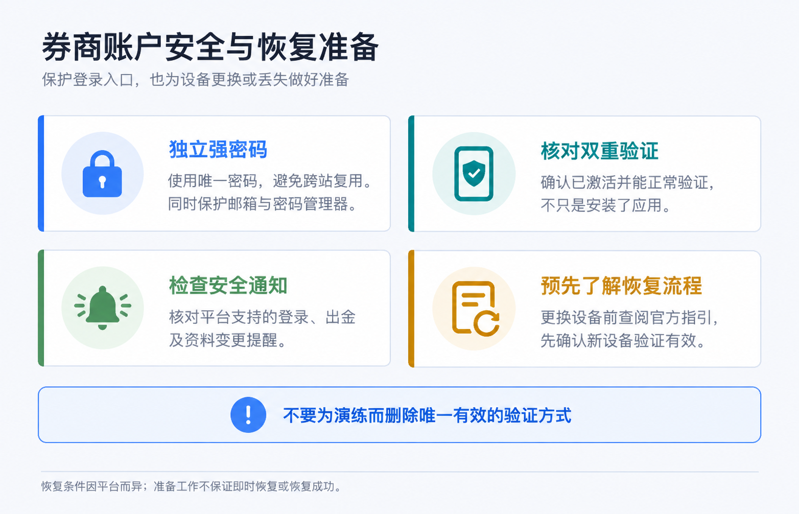

# 开户后第一天要设置什么：App、2FA、基础货币、交易权限和 W-8

券商账户审核通过后，很多人第一反应是入金、换汇、下单。

先检查官方入口、安全验证、基础货币、交易权限和适用税表，再确认资金路径与资料保存。不必为了完成这份清单而入金或下单。

如果申请还没有完成，先使用[IBKR 开户前的资料与权限核对清单](/blog/ibkr-before-open/)确认填写边界；本文只处理账户获批后的第一天。

> 本文为基于公开资料的开户后设置清单，不构成投资、税务或法律建议，也不是换汇或跨境汇款建议。不同券商、居住地和账户实体的设置入口会变化；本文不展示作者账户设置、入金或报表记录。操作前以当前 App、网页端和官方说明为准。资料核对日期：2026-08-23。

## 第一步：只安装官方 App

先做一件很小但很重要的事：确认你安装的是官方 App。

IBKR 可能涉及 IBKR Mobile、Client Portal、TWS、IBKR Desktop、GlobalTrader 等多个入口；嘉信可能涉及 Schwab Mobile、网页端和 thinkorswim。新手不要一上来把所有软件都装满。

可以这样分工：

| 入口 | 第一阶段用途 |
|---|---|
| 手机 App | 登录验证、查看账户、接收通知、必要时确认交易或资金操作。 |
| 网页端 | 设置账户、安全、税务表格、入出金、报表下载。 |
| 桌面交易软件 | 只有当你真的需要复杂订单、期权或高频查看行情时再用。 |

从核实后的券商官网进入应用下载页面，再核对应用商店的开发者和产品信息；仅仅出现在应用商店不代表一定是官方应用。不要通过微信群、Telegram、邮件附件或陌生“客服”发来的安装包安装金融 App。

[IBKR 防诈骗页面](https://www.interactivebrokers.com/en/general/warnings-on-frauds-and-scams.php)将索取登录详情、要求远程访问设备、要求通过电话转移股票或资金列为冒名联系的警讯。这是 IBKR 的提示，不代表所有券商完全相同的客服流程。遇到可疑联系先停止操作，从独立核实的官网找联系方式复核，不拨对方提供的号码、不交出密码，也不批准自己未发起的登录或资金操作。

## 第二步：立刻启用 2FA

开户后第一天，2FA 比下单更重要。

[嘉信 SchwabSafe](https://www.schwab.com/schwabsafe)建议启用安全提醒和两步验证。验证方式与触发频率按账户当前设置确认，不把所有账户都写成同一种短信流程。IBKR 用户也应检查本人账户支持且已启用的验证方式，而不是只确认手机上装了 App。

可以按这个顺序设置：

1. 设置一个只用于金融账户的强密码，并放进密码管理器。
2. 启用券商支持的 2FA 或移动端验证。
3. 确认手机号、邮箱和备用联系方式正确。
4. 检查平台提供的登录、资金转出、资料变更、订单成交等通知并按需启用；不是每个平台都有全部选项。
5. 记录恢复流程，但不要把恢复信息和密码放在同一个地方。

安全设置里容易漏的是恢复条件。[IB Key 重新激活指南](https://www.ibkrguides.com/securelogin/sls/reactivating-ibkr-mobile-authentication.htm)说明，自助重新激活的一项前提是仍能在首次激活所用号码接收短信；设备和实际验证步骤也要按指南处理。换手机号、丢失设备或收不到短信时，不应假设重新安装就能恢复，应从官方支持渠道核验身份并寻求协助。

建议换机前先阅读迁移说明，确认新设备验证成功后再处理旧设备；不要为了“演练恢复”主动删除唯一有效的验证方式。邮箱和密码管理器也要做好安全保护与独立备份。恢复速度及结果受身份核验等条件影响，不能保证当天完成。

## 第三步：检查基础货币和报表币种

如果是 IBKR，开户后要确认 Base Currency 是否符合你的长期记录方式。它用于汇总、报表及保证金计量，并关联部分费用和账户规则，不只是显示设置；也不等于每笔交易会自动换汇。[官方设置指南](https://www.ibkrguides.com/clientportal/basecurrency.htm)列出 Settings → Account Reporting → Base Currency，修改于下一交易日生效。可选币种及适用限制以本人账户为准，不能用它决定税务申报币种。

可以用三个问题判断：

1. 平时用什么币种做家庭资产复盘？
2. 主要买的资产以什么币种计价？
3. 未来报表、税务文件和转仓资料希望用什么币种对账？

如果你主要买美国 ETF，USD 往往更直观。如果你主要用港币做账户管理，可以考虑 HKD，但美股成本和股息税仍要单独理解。不要以为基础货币能帮你消除汇率风险。

嘉信这类美国券商账户通常更围绕美元运行。你要确认的是美元现金、银行入金、股息、税表和报表如何记录，而不是在账户里追求多币种显示。

## 第四步：把交易权限降到“够用”

开户后看到一堆可申请权限，很容易手痒。

IBKR 官方说明，交易权限按资产类别和国家拆分，可以在开户申请时选择，也可以之后通过 Client Portal 升级，升级要经过审核。嘉信也说明期权交易需要满足特定要求，期权风险高且不适合所有投资者。

以下是按用途整理的核对建议，不是统一的账户或权限推荐：

| 目标 | 第一阶段权限 |
|---|---|
| 长期买美股 ETF | 核对产品与市场权限；账户类型另按交收、借款需求和风险评估。延迟行情不能当当前可执行报价。 |
| 少量港股 + 美股 | 对应股票市场权限，先不碰衍生品。 |
| 暂时不交易 | 先完成安全和资料检查，不必为了测试而入金或下单。 |
| 想学期权 | 先学习和模拟，不要在第一天开真实期权权限。 |

不要为了“以后可能用”而开保证金、期权、期货、现货外汇、复杂杠杆产品和一堆实时行情。权限越多，误操作空间越大，也越容易让你在没准备好的情况下做高风险交易。

## 第五步：确认 W-8BEN

先确认美国税务身份，不只看国籍。W-8BEN 通常适用于符合条件的非居民外国个人；美国公民、居民外国个人等美国人士一般使用 W-9。不要因为持外国护照就自动选 W-8BEN。

IRS 官方说明：外国个人如果是相关收入的受益所有人，在扣缴义务人或付款方要求时，应向其提供 Form W-8BEN；无论是否申请较低预扣税率或免税待遇，被要求时都应提交。

几个重点：

1. W-8BEN 通常交给券商或付款方，不是你自己寄给 IRS。
2. 它用来证明外国身份，并用于美国预扣税和申报处理。
3. 姓名、国家、永久居住地址、税号和税收协定声明不能乱填。
4. 表格信息或适用资格变化时，按规则通知请求方并更新；IRS 对导致信息不正确的变化通常要求在 30 天内通知。到期前也应按账户提示办理，不将“已提交”当作永久有效。
5. 不确定税收协定和税号怎么填时，找专业人士，不要照抄网友模板。

表格有效期、股息预扣和 1042-S 的关系，可继续按[W-8BEN 与美股股息预扣的新手核对顺序](/blog/w8ben-dividend-withholding/)逐项确认。

## 第六步：先确认资金路径，再决定是否入金

安全、税表和权限确认后，再考虑入金。

先确认资金来源、汇款用途及路径均获相关银行和券商接受。开户通过、本人同名或金额小，都不能替代用途合规审查；没有实际资金需求时，不必为了测试而转账。如已确认可办理，以 IBKR 电汇为例核对：

1. 在券商端创建入金通知。
2. 核对汇出账户归属及该路径是否接受；收款银行和受益人字段照官方指示填写，不强行改成自己的姓名。
3. 按指定币种和收款信息汇出。
4. 保存银行凭证。
5. 分别核对已到账金额、币种、可交易状态和可提款状态；到账不代表立即可交易或转出。
6. 记录这条路径的费用和到账时间。

IBKR 入金页面提醒，电汇指示会因币种不同而变化，并且强烈不鼓励、通常会拒绝第三方入金。其说明也区分资金入账/可交易的 Credit Period 与提款限制 Withdrawal Hold Period。其他券商应核对自己的规则，不能直接照搬 IBKR 操作。一次小额成功也不证明后续金额或用途必然获准。

## 第七步：找到报表入口，保存实际可用资料

开户第一天还没有交易，也可以先看报表入口；不保证新账户立即能生成空白报表、成交确认或税表。只保存实际可用文件，不为了生成报表而做真实交易。

以 IBKR 为例，[报表指南](https://www.ibkrguides.com/clientportal/performanceandstatements/runstatement.htm)列出的入口为 Performance & Reports → Statements，或 Menu → Reporting → Statements。运行报表前选择正确账户、期间和格式；多账户汇总不等于逐账户结单。其他券商应使用各自当前入口。

你要知道在哪里下载：

| 文件 | 为什么要找入口 |
|---|---|
| Activity Statement / 月结单 | 以后对账、报税、转仓都会用。 |
| Trade Confirmation | 每笔交易的正式记录。 |
| Tax Forms | 年度税务资料入口，不要等报税时才找。 |
| Deposit / Withdrawal History | 证明资金路径和金额。 |
| Account Profile / 资料变更通知 | 核对当前资料，并另存实际收到的变更确认；资料页未必提供完整历史记录。 |

可以在本地建立一个文件夹：`brokerage/YYYY/broker-name/`，把月结单、税表、入出金凭证和重要通知按年份保存。原件保存在受访问控制、加密且有备份的位置；用于公开讨论的副本应遮挡账号、税号、地址和其他敏感信息，不覆盖原件。单纯建立文件夹不等于完成安全备份。

## 第一天下单前，最后问自己 5 个问题

如果前面都做完了，仍然不急着下单。再问自己：

1. 我是否知道这笔交易用哪种货币结算？
2. 我是否知道订单类型、有效期和成交价格边界？
3. 我是否知道交易后多久交收、卖出后多久能出金？
4. 我是否保存了资金来源、入金和账户资料？
5. 我是否开了任何自己还不理解的权限？

有不清楚的项目，先核实再决定是否下单；完成清单不代表账户或交易没有风险。

## 参考资料

- Charles Schwab, [SchwabSafe](https://www.schwab.com/schwabsafe).
- Charles Schwab, [Account Protection](https://www.schwab.com/legal/account-protection).
- Charles Schwab, [Pricing](https://www.schwab.com/pricing).
- Interactive Brokers, [Trading and Market Data](https://www.interactivebrokers.com/en/accounts/trading-and-market-data.php).
- Interactive Brokers, [Fund Your Account](https://www.interactivebrokers.com/en/support/fund-my-account.php).
- Interactive Brokers, [Warning on Frauds and Scams](https://www.interactivebrokers.com/en/general/warnings-on-frauds-and-scams.php).
- IRS, [About Form W-8 BEN](https://www.irs.gov/forms-pubs/about-form-w-8-ben).
- IRS, [Instructions for Form W-8BEN](https://www.irs.gov/instructions/iw8ben).
- Interactive Brokers, [Reactivating IBKR Mobile – IB Key](https://www.ibkrguides.com/securelogin/sls/reactivating-ibkr-mobile-authentication.htm).
- Interactive Brokers, [Base Currency](https://www.ibkrguides.com/clientportal/basecurrency.htm).
- Interactive Brokers, [How to Run a Statement](https://www.ibkrguides.com/clientportal/performanceandstatements/runstatement.htm).
