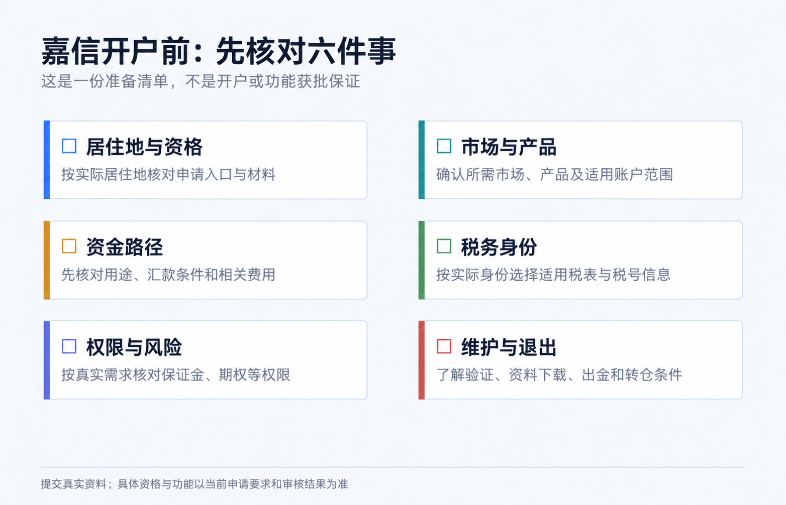

# 嘉信理财开户前认知：和 IBKR 有什么不同，新手要准备什么

很多人在比较嘉信理财和 IBKR 时，会直接问：哪个更好？

这个问题太粗。更准确的问法应该是：**我需要一个美国市场为主的长期投资账户，还是一个多市场、多币种、专业交易工具更强的账户？**

嘉信理财不是 IBKR 的简化版，IBKR 也不是嘉信的高级版。它们背后是两套不同的产品取向。选错了，不一定是钱的损失，更多是后续使用摩擦：入金路径不顺、权限不匹配、报表看不懂、想买的市场不支持、或者根本不适合你的身份和居住地。

> 本文为基于公开资料的开户前核对清单，不构成投资、税务或法律建议，也不是开户、换汇或跨境汇款建议。嘉信国际账户的开户资格、最低资金和可用功能会因居住地及政策变化而变化；本文不展示作者嘉信申请或账户使用结果。提交申请前请以 Charles Schwab / Schwab International 当前页面和客服确认为准。资料核对日期：2026-08-23。

## 一句话区别

**嘉信更像“美国投资账户生态”，IBKR 更像“全球交易基础设施”。**

这是本文按使用场景作的概括，不是两家券商的官方评级，也不是实际测评得出的优劣排序。下面将产品侧重与需要自己验证的事项分开：

| 维度 | 嘉信理财 | IBKR |
|---|---|---|
| 核心主场 | 美国股票、ETF、共同基金、期权、账户服务和投资者教育 | 多国家市场、多币种、低成本交易、专业订单和报表 |
| 需要验证的使用场景 | 所需美国证券、研究工具和服务是否可用 | 所需交易所、币种和订单是否在本人权限内 |
| 多币种能力 | 以美元账户体验为主，国际账户可用功能要看地区 | 多币种现金和跨市场交易是核心能力之一 |
| 市场覆盖 | 强在美国市场和相关工具 | 覆盖更广，适合多市场配置 |
| 操作学习 | 通过官方演示核对自己的下单、报表与安全流程 | 通过官方演示核对市场、币种、订单与保证金流程 |
| 权限风险 | 期权、保证金等须满足相应条件 | 产品、市场和账户权限须满足相应条件 |

只买美国上市 ETF 并不足以决定选哪家。比较时应列出具体证券、下单渠道和资金币种，再核对自己可用的产品与总费用。IBKR 官网列有多市场、多币种能力，但币种范围依签约实体而异，实际交易仍受账户权限限制；嘉信也不能概括成“完全不能交易美国以外的证券”，其外国证券交易渠道与收费需单独确认。

如果判断结果更偏向 IBKR，可继续查看[IBKR 开户前的账户类型、基础货币与权限核对清单](/blog/ibkr-before-open/)，不要把两家券商的申请字段直接互相套用。

## 嘉信适合谁

嘉信更适合这些人：

1. 主要投资美国上市股票、ETF、共同基金或债券。
2. 想要相对成熟的美国券商账户体验，而不是多市场交易终端。
3. 希望使用 Schwab Mobile、网页端和 thinkorswim 等工具。
4. 更看重账户服务、投教内容、报表和美国市场生态。
5. 能接受账户主要围绕美元运行，且资金路径能稳定解释。

嘉信不太适合这些人：

1. 需要频繁交易多个国家本地交易所。
2. 需要在券商内做多币种现金管理和低成本换汇。
3. 所在居住地对应的申请入口、身份材料或产品功能尚未确认。
4. 想用同一个账户同时解决港股、新加坡市场、外汇和复杂衍生品。
5. 不愿意处理 W-8BEN、美元电汇、账户安全和税务文件。

这里有一个容易被旧资料误导的点：截至 2026 年 8 月 23 日，[Schwab International 当前账户页](https://international.schwab.com/us-investing-brokerage-account)明确写明，Schwab One International 个人或联名账户的最低入金为 0 美元，开户和维护本身不收费。这个当前口径不应再与仍可被搜索到、但已经过时的旧版 25,000 美元申请 PDF 混用。

0 美元只是账户层面的最低入金，不等于任何居住地都保证可申请，也不等于所有功能都开放。资格、身份证明、地址材料、资金方式和产品范围仍应从[当前国际开户入口](https://international.schwab.com/open-account-intro)选择实际居住国家/地区后核对；申请是否通过仍由嘉信按个案审查。

## 和 IBKR 最大的不同，不是佣金

新手喜欢比较佣金，但嘉信和 IBKR 真正的区别不止佣金。

**第一，市场范围不同。**  
嘉信的强项是美国市场和美国投资账户生态。IBKR 的强项是跨市场、跨币种和专业交易工具。如果你未来会买港股、欧洲股票、不同货币债券或需要更广泛交易所接入，IBKR 更像底层平台。

**第二，币种体验不同。**  
嘉信账户体验主要围绕美元展开。IBKR 支持多币种入金和交易，官网也写到可以用多种交易货币入金。多币种不是“越多越好”，但如果你的资金和资产天然跨多个币种，IBKR 的现金和报表体系会更有用。

**第三，账户保护要分清。**  
按[嘉信账户保护说明](https://www.schwab.com/legal/account-protection)及 [SIPC 适用范围](https://www.sipc.org/for-investors/what-sipc-protects)，SIPC 主要在成员券商倒闭、客户证券或相关现金缺失时发挥作用，限额为 500,000 美元，其中现金限额为 250,000 美元；不是每个账户号码各自自动获得一份额度。[同一客户以相同身份持有的多个账户可能合并计算](https://www.sipc.org/for-investors/investors-with-multiple-accounts)，不同法律身份的账户按相应规则判断。

银行存款则需确认是否存放于 FDIC 受保银行，标准限额通常按每位存款人、每家受保银行、每个所有权类别 250,000 美元计算。不要只看账户总余额判断保障：证券、待投资现金、转入银行的存款和货币市场基金应分别识别，货币市场基金不是银行存款。

这不是“所有余额都无风险”。证券价格下跌、基金净值波动、期权亏损和投资判断错误，都不是 SIPC 或 FDIC 负责的范围。

**第四，工具取向不同。**  
嘉信的长期投资、教育、研究、客服和 thinkorswim 生态更适合美国市场投资者。IBKR 的订单、算法、市场覆盖、保证金、外汇和 API 能力更像专业交易基础设施。新手不要把“功能更多”自动理解为“更适合我”。

## 新手开户前要准备什么

如果你准备申请嘉信，先把这些东西整理好：

| 模块 | 准备内容 |
|---|---|
| 身份证明 | 护照或当前申请路径接受的政府身份证明，姓名拼写要和银行账户一致。中国居民应按当前中国路径核对可接受的身份证件组合。 |
| 地址证明 | 当前申请路径接受的近期居住地址文件，姓名和地址应与申请资料一致。中国居民可在当前中国路径核对可接受的居住/户籍材料。 |
| 税务信息 | 税务居民身份、税号、W-8BEN 所需信息。 |
| 资金路径 | 本人同名美元入金路径；如果用电汇，要能保存汇款凭证。 |
| 职业和资金来源 | 工作、收入、资产来源、投资目的，按真实情况填写。 |
| 联系方式 | 稳定手机号、邮箱、登录设备和安全验证方式。 |
| 交易计划 | 先确定是长期 ETF/股票，还是还要申请期权、保证金、thinkorswim 等功能。 |

资金路径不要只写“电汇”或“ACH”四个字；[嘉信电汇、ACH 与资金可用时间的核对方法](/blog/schwab-funding-routes/)可以用来提前确认收款信息、费用和到账后的限制。

对符合条件的非美国个人来说，W-8BEN 很重要。[IRS 填表说明](https://www.irs.gov/instructions/iw8ben)要求外国个人受益所有人在适用情形下向要求该表的扣缴义务人或金融机构提供文件，即使不主张协定优惠也可能需要提供。不要将 W-8BEN 寄给 IRS；应交给要求该表的机构。美国税务居民等美国人士通常使用 W-9，不能只按国籍选择表格；涉及其他身份或收入类型时须核对适用表格。

## 哪些选项不要乱填

税务文件、安全设置和交易权限是不同事项。W-8BEN 是适用身份下的税务文件，不是交易功能开关；小额入金也须先确认路径和用途被允许，不能作为绕过资格审查的办法。

**1. 不要把自己填成美国居民。**  
如果你不是美国税务居民、没有真实美国居住地址，不要为了开户方便随便填写美国地址或身份。地址、税务、电话和银行资料后面都可能互相校验。

**2. 不要默认申请保证金。**  
不要为了“功能完整”而申请自己尚未理解的权限。先写清是否有融资或特定策略需求，再核对现金账户与保证金账户各自的限制；不把某一种账户类型当作所有新手的统一起点。入金、下单、报表和税务资料也应分别理解，不必通过真实交易来试验。

**3. 不要为了试试而申请期权。**  
嘉信定价页面提醒，期权有高风险，并非适合所有投资者，交易期权需要满足特定要求。你能申请，不代表你应该申请。

**4. 不要把产品页列出的功能理解为无条件开放。**
Schwab International 当前产品页列有支票、借记卡和现金管理功能，但实际可用性仍可能受居住地、账户类型、产品条款和审批结果影响。看到功能名称后，还要在自己的申请路径和账户文件中确认。

**5. 不要只看“零佣金”。**  
嘉信主站显示，美国上市股票和 ETF 网上交易为 0 美元佣金，期权为 0 美元基础佣金加每张合约 0.65 美元；但 OTC、交易费基金、固定收益、外汇市场、直接在外国交易所下单、经纪协助交易、行业费、ADR 费、借券费等可能另有费用。真实成本不是一个“0”字。

2026 年 9 月 13 日核对的官方收费指南还区分下单渠道：普通期权的每张 0.65 美元是网上交易标准费率，部分低价买入平仓有豁免；外国普通股直接在外国交易所的交易另有渠道与费用条件。该指南对 Charles Schwab, Hong Kong, Ltd. 客户不直接适用，其另有收费指南。比较两家券商时，不要拿一个账户可用的标准费率代表所有客户，也不要把 IBKR Lite 的零佣金当作所有 IBKR 账户的费率。

## 如何在嘉信与 IBKR 之间判断

如果主要目标是美国市场长期配置，并且希望账户体验更接近传统大型美国券商，可以把嘉信列为优先研究对象。

如果已明确需要港股、美股、多个币种、不同交易所、低成本换汇或更细的交易权限管理，可以把 IBKR 列为优先研究对象。

如果还没想清楚要买什么，只是看到别人说“嘉信稳”或“IBKR 强”，更稳妥的做法是先不开户，先写一张表：

| 问题 | 你的答案 |
|---|---|
| 未来 12 个月主要买什么市场 | 美股、港股、债券、ETF、期权还是其他 |
| 账户主币种是什么 | USD、HKD、CNY 或其他 |
| 入金路径是什么 | 同名银行、电汇、ACH、FPS、Wise 或其他 |
| 是否需要保证金 | 不需要、以后再说、现在明确需要 |
| 是否需要期权 | 不需要、学习中、已经有经验 |
| 税务资料是否准备好 | W-8BEN、地址、税号、报表保存 |
| 退出或迁移安排是否清楚 | 账户受限时的联系渠道、转出条件，以及关户前需要下载的资料 |

这张表用于整理需求，不直接得出哪家券商更好的结论。对尚未确认的项目，保留问题并向对应机构核实，不用别人的开户或转账结果代替自己的资格与账户条件。

## 参考资料

- Charles Schwab International, [U.S. Investing Brokerage Account](https://international.schwab.com/us-investing-brokerage-account)及[当前开户入口](https://international.schwab.com/open-account-intro)。
- Charles Schwab International, 中国居民申请材料页面：[身份证明](https://international.schwab.com/open-account-step-2CHI)与[居住证明](https://international.schwab.com/open-account-step-3CHI)。
- Charles Schwab, [Pricing Guide for Individual Investors](https://www.schwab.com/legal/schwab-pricing-guide-for-individual-investors).
- Charles Schwab, [Account Protection](https://www.schwab.com/legal/account-protection).
- Charles Schwab, [Security](https://www.schwab.com/security).
- Interactive Brokers, [Personal Brokerage Accounts](https://www.interactivebrokers.com/en/accounts/individual.php).
- Interactive Brokers, [Trading and Market Data](https://www.interactivebrokers.com/en/accounts/trading-and-market-data.php).
- Interactive Brokers, [Fund Your Account](https://www.interactivebrokers.com/en/support/fund-my-account.php).
- IRS, [About Form W-8 BEN](https://www.irs.gov/forms-pubs/about-form-w-8-ben).
